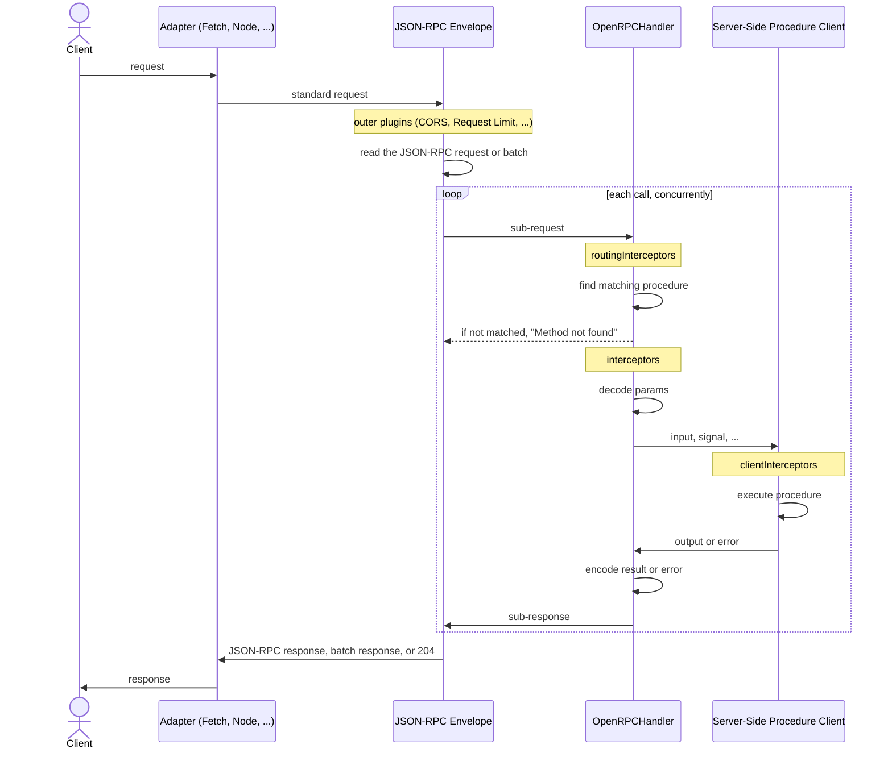

## Overview

`OpenRPCHandler` serves your [router](/docs/router) as a [JSON-RPC 2.0](/docs/openrpc/protocol) API over HTTP `POST`, for [OpenRPC Link](/docs/openrpc/link) or any other JSON-RPC client. Pair it with the [OpenRPC Generator](/docs/openrpc/specification) to describe the API in an OpenRPC document.

```package-install
npm install @orpc/openrpc@beta
```

<CodeGroup>

```ts fetch
import { OpenRPCHandler } from '@orpc/openrpc/fetch'
import { onError } from '@orpc/server'
import { CORSHandlerPlugin } from '@orpc/server/plugins'

const handler = new OpenRPCHandler(router, {
  plugins: [
    new CORSHandlerPlugin(),
  ],
  interceptors: [
    onError((error) => {
      console.error(error)
    }),
  ],
})

export async function fetch(request: Request) {
  const { matched, response } = await handler.handle(request, {
    prefix: '/rpc',
    context: {}, // Provide initial context if needed, can be an async function
  })

  if (matched) {
    return response
  }

  return new Response('Not Found', { status: 404 })
}
```

```ts node
import { createServer } from 'node:http' // or 'node:https' or 'node:http2'
import { OpenRPCHandler } from '@orpc/openrpc/node'
import { onError } from '@orpc/server'
import { CORSHandlerPlugin } from '@orpc/server/plugins'

const handler = new OpenRPCHandler(router, {
  plugins: [
    new CORSHandlerPlugin(),
  ],
  interceptors: [
    onError((error) => {
      console.error(error)
    }),
  ],
})

const server = createServer(async (req, res) => {
  const { matched } = await handler.handle(req, res, {
    prefix: '/rpc',
    context: {}, // Provide initial context if needed, can be an async function
  })

  if (matched) {
    return
  }

  res.statusCode = 404
  res.end('Not found')
})

server.listen(3000, '127.0.0.1', () => console.log('Listening on 127.0.0.1:3000'))
```

```ts fastify
import { OpenRPCHandler } from '@orpc/openrpc/fastify'
import { onError } from '@orpc/server'
import { CORSHandlerPlugin } from '@orpc/server/plugins'
import Fastify from 'fastify'

const handler = new OpenRPCHandler(router, {
  plugins: [
    new CORSHandlerPlugin(),
  ],
  interceptors: [
    onError((error) => {
      console.error(error)
    }),
  ],
})

const app = Fastify()

// Let oRPC parse request bodies, see Framework Body Parsers below
app.removeAllContentTypeParsers()
app.addContentTypeParser('*', (request, payload, done) => {
  done(null, undefined)
})

app.all('/rpc', async (req, reply) => {
  const { matched } = await handler.handle(req, reply, {
    prefix: '/rpc',
    context: {}, // Provide initial context if needed, can be an async function
  })

  if (matched) {
    return reply
  }

  return reply.status(404).send('Not found')
})

app.listen({ port: 3000 }).then(() => console.log('Listening on port 3000'))
```

```ts aws-lambda
import type { APIGatewayProxyEventV2, AwsLambdaGlobal } from '@standard-server/aws-lambda'
import { OpenRPCHandler } from '@orpc/openrpc/aws-lambda'
import { onError } from '@orpc/server'
import { CORSHandlerPlugin } from '@orpc/server/plugins'

declare const awslambda: AwsLambdaGlobal

const handler = new OpenRPCHandler(router, {
  plugins: [
    new CORSHandlerPlugin(),
  ],
  interceptors: [
    onError((error) => {
      console.error(error)
    }),
  ],
})

export const rpc = awslambda.streamifyResponse<APIGatewayProxyEventV2>(async (event, responseStream, context) => {
  const { matched } = await handler.handle(event, responseStream, {
    prefix: '/rpc',
    context: {}, // Provide initial context if needed, can be an async function
  })

  if (matched) {
    return
  }

  awslambda.HttpResponseStream.from(responseStream, {
    statusCode: 404,
    headers: {},
    cookies: [],
  }).end('Not found')
})
```

</CodeGroup>

:::info
Use the fetch adapter with runtimes and frameworks built on the Fetch API, such as [Hono](/docs/adapters/hono), [Next.js](/docs/adapters/next), Bun, Deno, or [Cloudflare Workers](/docs/adapters/cloudflare-workers), and the node adapter with [Express](/docs/adapters/express). The AWS Lambda adapter requires [response streaming](/docs/adapters/aws-lambda), like the other handlers.
:::

:::tip
`context` also accepts a sync or async function that receives the HTTP request. It runs once per HTTP request, and its result is shared by every call of a [batch](#batch-requests):

```ts
const { matched, response } = await handler.handle(request, {
  prefix: '/rpc',
  context: async () => ({ session: await getSession(request) }),
})
```

:::

## Endpoint and Prefix

With `prefix: '/rpc'`, the JSON-RPC endpoint is exactly `/rpc` (a trailing slash and a query string are allowed). Without a prefix, every `POST` request the handler receives is read as JSON-RPC.

Other requests, such as a `GET` or a `POST` to another path under the prefix, pass through the handler untouched, so plugins such as [Service Discovery](/docs/openrpc/specification#service-discovery) can serve them. When nothing does, the handler returns `matched: false`.

:::info
Unlike [RPC Handler](/docs/rpc/handler), every procedure shares the one endpoint, and the JSON-RPC `method` selects the procedure, see [Methods](/docs/openrpc/protocol#methods).
:::

## Batch Requests

The handler answers [batch requests](/docs/openrpc/protocol#batch-requests) natively. Each call runs concurrently through the rest of the handler, with its own [interceptors](#interceptors), middleware, and per-call plugins, and shares the HTTP request headers, abort signal, and initial context.

A batch may contain up to `DEFAULT_JSON_RPC_MAX_BATCH_SIZE` (100) requests. Larger batches are rejected with HTTP `413` and the error code `-32013`. Use `maxBatchSize` to change the limit, as a number or a (async) function of the request. With `0`, every batch is rejected with the message "Batch requests are not supported.":

```ts
const handler = new OpenRPCHandler(router, {
  maxBatchSize: ({ request }) => request.headers['x-api-key'] !== undefined ? 100 : 10,
})
```

:::warning
A batch turns one HTTP request into many procedure calls. Rate limit the calls themselves, for example with the [Ratelimit Middleware](/docs/helpers/ratelimit#ratelimit-middleware), which runs once per call, instead of only counting HTTP requests.
:::

The batch response carries the headers that every call's response shares with the same value, all of their `set-cookie` headers, and a merged `vary` header.

If a [routing interceptor](#interceptors) throws for a call, for example through the [Rethrow Plugin](/docs/plugins/rethrow), that call gets a `-32603` "Internal error" response, and the error is reported as an unhandled rejection, so a global handler can log it. For a single call, the error is thrown from `handler.handle` instead.

## Notifications

The handler runs [notifications](/docs/openrpc/protocol#notifications) to completion before it sends the empty `204` response, so serverless and edge runtimes cannot cut off their work. Their errors are never sent to the client, but [interceptors](#interceptors) still see them:

```ts
const handler = new OpenRPCHandler(router, {
  interceptors: [
    onError((error) => {
      console.error(error) // includes notification errors
    }),
  ],
})
```

## HTTP Status Codes

Generic JSON-RPC clients expect HTTP `200` for every JSON-RPC response, errors included, so that is the default. Set `errorResponseStatus: 'mapped'` to give a single call that fails the status of its error, so HTTP-level tooling, such as the [Retry After Plugin](/docs/plugins/retry-after), caches, load balancers, and metrics, sees the failure:

```ts
const handler = new OpenRPCHandler(router, {
  errorResponseStatus: 'mapped',
})
```

| Response                              | `'always-200'` (default) | `'mapped'`                                           |
| ------------------------------------- | ------------------------ | ---------------------------------------------------- |
| Success                               | `200`                    | `200`                                                |
| Procedure error                       | `200`                    | From `errorStatusMap`, such as `404` for `NOT_FOUND` |
| Parse error, Invalid Request          | `200`                    | `400`                                                |
| Method not found                      | `200`                    | `404`                                                |
| Internal error                        | `200`                    | `500`                                                |
| Batch response                        | `200`                    | `200`                                                |
| Notification                          | `204`                    | `204`                                                |
| Unsupported `Content-Type`, too large | `415`, `413`             | `415`, `413`                                         |

Procedure error statuses come from `errorStatusMap`, see [Custom Error Response](#custom-error-response). Plugins inside the handler see each call's status in either mode, for example the [Rate Limit Plugin](/docs/helpers/ratelimit#handler-plugin) only adds `retry-after` to a call that failed.

## Content Types and CSRF

The handler only reads JSON-RPC requests with a JSON `Content-Type`: `application/json`, `application/json-rpc`, or `application/jsonrequest`, and rejects any other with HTTP `415`. None of them is [CORS-safelisted](https://developer.mozilla.org/en-US/docs/Glossary/CORS-safelisted_request_header), so browsers send a [preflight request](https://developer.mozilla.org/en-US/docs/Glossary/Preflight_request) before any cross-site JSON-RPC request, and HTML forms cannot send one. This protects the endpoint from [CSRF](https://developer.mozilla.org/en-US/docs/Web/Security/Attacks/CSRF) without extra plugins.

To accept cross-origin requests from browsers, add the [CORS Plugin](/docs/plugins/cors).

## Interceptors

The handler reads the HTTP request in a routing interceptor added by `OpenRPCEnvelopeHandlerPlugin`, then runs every JSON-RPC call as its own sub-request through the rest of the handler. As a result, `routingInterceptors`, `interceptors`, `clientInterceptors`, and most plugins run once per call and see that call's sub-request:

- Its method is `POST`, and its URL is the prefix plus the procedure path, such as `/rpc/planet/find`, which only serves logs and traces.
- Its headers and abort signal are the HTTP request's, and its body is the call's `params`.

Use `getJsonRpcCall` to read the JSON-RPC call of a sub-request. It returns `undefined` for any other request:

```ts
import { getJsonRpcCall } from '@orpc/openrpc/standard'

const handler = new OpenRPCHandler(router, {
  interceptors: [
    async ({ next, request, path }) => {
      const call = getJsonRpcCall(request)

      console.log(path.join('.'), call?.id, call?.notification, call?.batch)

      return next()
    },
  ],
})
```

To see the HTTP request itself once per request, use the [`context` function](#overview), or a plugin ordered after `~openrpc`, whose routing interceptor wraps the JSON-RPC envelope:

```ts
const handler = new OpenRPCHandler(router, {
  plugins: [
    {
      name: 'http-logger',
      after: ['~openrpc'],
      init: options => ({
        ...options,
        routingInterceptors: [
          async ({ next, request }) => {
            console.log(request.method, request.url) // once per HTTP request
            return next()
          },
          ...(options.routingInterceptors ?? []),
        ],
      }),
    },
  ],
})
```

:::info
`interceptors` see the response of each call before the envelope completes it: `{ result }` on success or `{ error }` with a JSON-RPC error object. An interceptor that replaces it with anything else makes the call fail with `-32603` "Internal error".
:::

## Plugins

Plugins package reusable interceptors. The JSON-RPC envelope orders itself among them, so each plugin works on the HTTP request or on each call as it should:

| Plugin | Support |
| --- | --- |
| [CORS](/docs/plugins/cors), [Request Limit](/docs/plugins/request-limit), [Request Compression](/docs/plugins/request-compression), [Response Compression](/docs/plugins/response-compression), [Response Headers](/docs/plugins/response-headers), [Tmp File Upload](/docs/plugins/tmp-file-upload) | Supported, once per HTTP request. Response Headers shares one `resHeaders` with every call, so in a batch the last call to set a header wins. |
| [OpenTelemetry](/docs/integrations/opentelemetry), [Pino](/docs/integrations/pino), [Evlog](/docs/integrations/evlog), [Timeout](/docs/plugins/timeout), [Signal Sync](/docs/plugins/signal-sync), [Request Headers](/docs/plugins/request-headers), [Smart Coercion](/docs/plugins/smart-coercion), [Rate Limit](/docs/helpers/ratelimit#handler-plugin), [Rethrow](/docs/plugins/rethrow) | Supported, once per call, so each call gets its own trace span and log entries. Rethrow throws from `handler.handle` for a single call, while a batch call gets `-32603` "Internal error". |
| [Service Discovery](/docs/openrpc/specification#service-discovery), [OpenAPI Reference](/docs/plugins/openapi-reference), [Static File](/docs/plugins/static-file) | Supported, for the `GET` requests that pass through the envelope. |
| [Batch](/docs/plugins/batch) | Not supported, JSON-RPC has its own [batch requests](#batch-requests). |
| [Method Override](/docs/plugins/method-override), [GET Method CSRF Protection](/docs/plugins/get-method-csrf-protection), [Batch Response Compression](/docs/plugins/batch-response-compression), [Hibernation](/docs/integrations/hibernation) | Not applicable, no effect. |

:::tip
Add the [Smart Coercion Plugin](/docs/plugins/smart-coercion) to coerce params such as dates or bigints, which JSON carries as strings, before input validation.
:::

## Filtering Procedures

Use the `filter` option to exclude procedures, which then answer "Method not found". Pass the same filter to the [OpenRPC Generator](/docs/openrpc/specification#filtering-procedures), so the document lists exactly the methods the handler serves:

```ts
const handler = new OpenRPCHandler(router, {
  filter: (procedure, path) => !path.includes('internal'),
})
```

:::info
Procedures with an [AsyncIteratorObject](/docs/async-iterator-object) input or output schema are always excluded, since JSON-RPC over HTTP cannot stream.
:::

## Custom Error Response

Three options control how an [ORPCError](/docs/error-handling#orpcerror-class) is sent:

- `errorCodeMap` maps oRPC error codes to JSON-RPC error codes, `COMMON_JSON_RPC_ERROR_CODE_MAP` by default. A given map replaces the default, see [Error Codes](/docs/openrpc/protocol#error-codes).
- `errorStatusMap` maps oRPC error codes to the HTTP status of each call, `COMMON_ERROR_STATUS_MAP` by default. It only becomes the response status with [`errorResponseStatus: 'mapped'`](#http-status-codes), or when the whole HTTP request is rejected, such as with `413` or `415`. Codes missing from the map fall back to `400`.
- `customErrorEncoder` replaces the JSON-RPC error object of an error. Return `null` or `undefined` to use the default.

```ts
import { COMMON_ERROR_STATUS_MAP, COMMON_JSON_RPC_ERROR_CODE_MAP } from '@orpc/openrpc'

const handler = new OpenRPCHandler(router, {
  errorCodeMap: {
    ...COMMON_JSON_RPC_ERROR_CODE_MAP,
    OUT_OF_STOCK: 1001,
  },
  errorStatusMap: {
    ...COMMON_ERROR_STATUS_MAP,
    OUT_OF_STOCK: 409,
  },
  customErrorEncoder: (error) => {
    if (error.code === 'OUT_OF_STOCK') {
      return {
        code: 1001,
        message: error.message,
        data: error.data, // only the error data, without the oRPC error code
      }
    }

    // fallback to default by returning null or undefined
    return null
  },
})
```

:::warning
`customErrorEncoder` must return a valid JSON-RPC error object, with an integer `code` and a string `message`, and must not throw. An invalid error object makes the call fail with `-32603` "Internal error". Errors encoded without the default `data` reach [OpenRPC Link](/docs/openrpc/link#error-responses) as foreign errors, so configure its `customErrorDecoder` to restore them.
:::

## Custom Serializer

Results and error data are serialized like [OpenAPI responses](/docs/openapi/serializer). To support more types, pass an `OpenAPIJsonSerializer` from `@orpc/openapi` with custom handlers as `serializer`, and give the same serializer to the [OpenRPC Generator](/docs/openrpc/specification#openrpc-generator) and [OpenRPC Link](/docs/openrpc/link#options):

```ts
const serializer = new OpenAPIJsonSerializer({
  handlers: {
    person: {
      condition: value => value instanceof Person,
      serialize: (value: Person) => ({ name: value.name, age: value.age }),
    },
  },
})

const handler = new OpenRPCHandler(router, {
  serializer,
})
```

## Framework Body Parsers

Frameworks that parse request bodies themselves can answer a JSON-RPC request before oRPC sees it:

- **Express**: when a body parser such as `express.json()` runs first, oRPC uses its parsed body, but Express answers invalid JSON with its own error instead of `-32700` "Parse error". Register body parsers after the oRPC middleware, as shown in the [Express Adapter](/docs/adapters/express).
- **Fastify**: Fastify answers invalid JSON with its own error and rejects `application/json-rpc` with `415`. Register the catch-all content type parser shown in the [overview](#overview) so oRPC handles both. Bodies parsed this way skip Fastify's [`bodyLimit`](https://fastify.dev/docs/latest/Reference/Server/#bodylimit), so limit them with the [Request Limit Plugin](/docs/plugins/request-limit).

## Custom Adapters

`OpenRPCHandler` combines a `StandardHandler` from `@orpc/server/standard` with two parts you can use to serve JSON-RPC from any [standard request](https://github.com/middleapi/standard-server):

- `OpenRPCEnvelopeHandlerPlugin` reads the JSON-RPC requests and runs each call as a sub-request.
- `OpenRPCHandlerCodec` resolves those sub-requests to procedures, decodes params, and encodes results and errors. It never resolves another request, so always use it with the plugin.

```ts
import { OpenRPCEnvelopeHandlerPlugin, OpenRPCHandlerCodec } from '@orpc/openrpc/standard'

const codec = new OpenRPCHandlerCodec(router, {
  filter: (procedure, path) => !path.includes('internal'),
})

const standardHandler = new StandardHandler(codec, {
  plugins: [
    new OpenRPCEnvelopeHandlerPlugin({ maxBatchSize: 20 }),
  ],
})

const { matched, response } = await standardHandler.handle(standardRequest, {
  prefix: '/rpc',
  context: {},
})
```

Pass the options both parts accept, `serializer`, `errorCodeMap`, `errorStatusMap`, and `customErrorEncoder`, to both of them.

## Lifecycle

The diagram below shows how a request flows through `OpenRPCHandler` and where each interceptor type runs:



:::info
The server-side procedure client follows the [Server-Side Client Lifecycle](/docs/client/server-side#lifecycle), and `clientInterceptors` behave like server-side client `interceptors`.
:::
