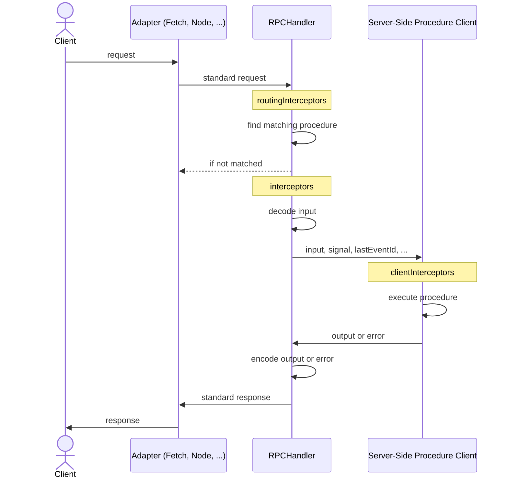

## Overview

`RPCHandler` serves [RPC Link](/docs/rpc/link) clients, or any client that implements the [RPC protocol](/docs/rpc/protocol):

```ts
const handler = new RPCHandler(router, {
  interceptors: [
    async ({ next, path }) => {
      console.time(path.join('.'))

      try {
        return await next()
      }
      catch (err) {
        console.error(`${path.join('.')}:`, err)
        throw err
      }
      finally {
        console.timeEnd(path.join('.'))
      }
    }
  ],
  plugins: [
    new CORSHandlerPlugin()
  ],
})
```

:::info
The actual usage of `RPCHandler` depends on the adapter you use. For example, when using the fetch adapter, the handler is used like this:

```ts
export async function fetch(request: Request) {
  const { matched, response } = await handler.handle(request, {
    prefix: '/rpc',
    context: {} // <- provide initial context if needed
  })

  if (matched) {
    return response
  }

  return new Response('Not Found', { status: 404 })
}
```

:::

:::tip
`context` also accepts a sync or async function that receives the standard request. The handler only calls it once the request matches `prefix`, so work such as loading a session is skipped for requests that other routes serve:

```ts
const { matched, response } = await handler.handle(request, {
  prefix: '/rpc',
  context: async () => ({ session: await getSession(request) }),
})
```

:::

:::warning
To better support `Blob`, `File`, and `ReadableStream<Uint8Array>` at the root level in cross-origin scenarios,
extend your [CORS allowlist](https://developer.mozilla.org/en-US/docs/Glossary/CORS-safelisted_response_header) to allow clients to read the `Content-Disposition` and `Standard-Server` response headers. Learn more in the [Standard Server documentation](https://github.com/middleapi/standard-server#how-body-parsing-works). If you use the [CORS Plugin](/docs/plugins/cors), include them in `exposeHeaders`:

```ts
const cors = new CORSHandlerPlugin({
  exposeHeaders: ['Content-Disposition', 'Standard-Server'],
})
```

:::

## Supported HTTP Methods

By default, `RPCHandler` only responds to `POST`, `PUT`, `PATCH`, and `DELETE` requests. Any other method, such as `GET` or `HEAD`, is treated as unmatched, as if no procedure exists at that path.

This keeps procedures out of reach of plain links, which browsers follow with `GET`. Cross-site, browsers can only send these methods after a [CORS preflight](https://developer.mozilla.org/en-US/docs/Glossary/Preflight_request) or from an HTML form, and the handler's [CSRF protection](#csrf-protection) rejects the form. Safe methods like `GET` or `HEAD` are excluded because invoking a procedure can modify data.

Use `allowMethods` to replace the allowlist: tighten it to `POST` only, or also accept [`QUERY`](https://datatracker.ietf.org/doc/draft-ietf-httpbis-safe-method-w-body/), which reads input from the request body and stays preflight-protected:

```ts
const handler = new RPCHandler(router, {
  allowMethods: ['POST', 'PUT', 'PATCH', 'DELETE', 'QUERY'],
})
```

### Enabling the GET Method

:::danger[Dangerous with cookie-based authentication]
Enabling `GET` is dangerous when your application stores tokens in cookies not marked `SameSite=Strict`. These cookies **are still sent on cross-site top-level navigations**, so an attacker only needs a signed-in user to click a link like `https://example.com/rpc/planet/delete?data=...` and the procedure runs with the victim's cookies. No JavaScript, no CORS bypass.

To enable `GET` safely, do one of the following:

- Set authentication cookies to `SameSite=Strict`, which browsers never send cross-site
- Use an independent protection, such as the [GET Method CSRF Protection Plugin](/docs/plugins/get-method-csrf-protection)
- Allow `GET` only for safe procedures that never modify data, as shown below

Learn more about this attack on [MDN](https://developer.mozilla.org/en-US/docs/Web/Security/Attacks/CSRF) and in the [OWASP CSRF Prevention Cheat Sheet](https://cheatsheetseries.owasp.org/cheatsheets/Cross-Site_Request_Forgery_Prevention_Cheat_Sheet.html).
:::

Add `GET` to `allowMethods` to enable it for every procedure:

```ts
import { GetMethodCsrfProtectionHandlerPlugin } from '@orpc/server/plugins'
import { RPC_DEFAULT_ALLOW_METHODS } from '@orpc/server/standard'

const handler = new RPCHandler(router, {
  allowMethods: ['GET', ...RPC_DEFAULT_ALLOW_METHODS],
  plugins: [
    new GetMethodCsrfProtectionHandlerPlugin(), // reject GET navigations that may carry SameSite=Lax cookies
  ],
})
```

The plugin rejects the navigations another site can use to send `SameSite=Lax` cookies, such as link clicks and redirects, while cookie-less requests such as `fetch` keep working. See the [GET Method CSRF Protection Plugin](/docs/plugins/get-method-csrf-protection) page for its cookie requirements.

Or pass a function to decide per request. For example, only allow `GET` for procedures that declare it via [OpenAPI metadata](/docs/openapi/routing):

```ts
import { getOpenAPIMeta, openapi } from '@orpc/openapi'
import { RPC_DEFAULT_ALLOW_METHODS } from '@orpc/server/standard'

const listPlanets = os
  .meta(openapi({ method: 'GET', path: '/planets' }))
  .handler(() => ['Earth', 'Mars'])

const handler = new RPCHandler({ listPlanets }, {
  allowMethods: (method, procedure, path) => {
    if (method === 'GET' && getOpenAPIMeta(procedure)?.method === 'GET') {
      return true
    }

    return RPC_DEFAULT_ALLOW_METHODS.includes(method)
  },
})
```

## CSRF Protection

A page on another site can make the browser send some requests without a [CORS preflight](https://developer.mozilla.org/en-US/docs/Glossary/Preflight_request), with the user's cookies attached. An HTML form can submit a `multipart/form-data` body whose `data` field holds RPC input, which gives the attacker full control of the input. `RPCHandler` rejects these requests with a `403 FORBIDDEN` before decoding their input. This protection is on by default.

A request that reads its input from the body is rejected when both of these are true:

- Its `Content-Type` is missing or [CORS-safelisted](https://developer.mozilla.org/en-US/docs/Glossary/CORS-safelisted_request_header): `application/x-www-form-urlencoded`, `multipart/form-data`, or `text/plain`.
- It does not carry the `orpc-protocol` header, and the browser did not mark it `Sec-Fetch-Site: same-origin`.

| Request | |
| --- | --- |
| HTML form from another site, including a sibling subdomain | rejected |
| `fetch` with `mode: 'no-cors'` or `navigator.sendBeacon` from another site | rejected |
| form, text, or empty body without `orpc-protocol` or `Sec-Fetch-Site`, such as from `curl` or over plain HTTP | rejected |
| [RPC Link](/docs/rpc/link), which sends `orpc-protocol` on every request with a body | allowed |
| `Content-Type: application/json` and other types that need a preflight | allowed |
| HTML form from the same origin, such as one using the [Method Override Plugin](/docs/plugins/method-override) | allowed |

The `orpc-protocol` header works because it is not CORS-safelisted. Another site can only send it after a preflight that your [CORS policy](/docs/plugins/cors) approves. Clients that implement the [RPC protocol](/docs/rpc/protocol) themselves should send `orpc-protocol: rpc` with every request that has a body.

:::warning
If you set `allowHeaders` in the [CORS Plugin](/docs/plugins/cors), or configure CORS elsewhere, include `orpc-protocol`. Otherwise browsers reject every cross-origin preflight from RPC Link:

```ts
const cors = new CORSHandlerPlugin({
  allowHeaders: ['Content-Type', 'orpc-protocol'],
})
```

:::

`csrfProtection` disables the protection, or decides per request. A function runs only for requests the protection would reject; return `false` to let one through. For example, to accept a webhook from a service that posts form-encoded bodies:

```ts
const handler = new RPCHandler(router, {
  csrfProtection: (request, procedure, path) => path.join('.') !== 'webhooks.payment',
})
```

:::warning
Any procedure you exempt can be called from a cross-site form with the user's cookies. Only exempt procedures that do not rely on cookies, such as webhooks that verify a signature.
:::

The protection does not cover:

- `GET` requests, which read input from the URL. See [Enabling the GET Method](#enabling-the-get-method).
- The [WebSocket](/docs/adapters/websocket) and [Message Port](/docs/adapters/message-port) adapters. Whoever holds the connection writes every request header there, so these adapters have no `csrfProtection` option. Browsers can attach cookies to a WebSocket handshake from another site, so check the `Origin` header before you upgrade a connection that cookies authenticate.

Mark authentication cookies `SameSite=Lax` or `SameSite=Strict` as well, as [defense in depth](https://cheatsheetseries.owasp.org/cheatsheets/Cross-Site_Request_Forgery_Prevention_Cheat_Sheet.html#samesite-cookie-attribute).

## Interceptors

Interceptors let you observe or change different stages of an RPC request. Common use cases include logging, error handling, and metrics.

### Routing Interceptors

Routing interceptors run on every request before routing. Use them when you need to handle all requests, including requests that do not match a procedure.

```ts
const handler = new RPCHandler(router, {
  routingInterceptors: [
    async ({ next, request, context }) => {
      if (condition) {
        return { matched: false }
      }

      const { matched, response } = await next()
      return { matched, response }
    },
  ],
})
```

### Interceptors

These interceptors run only for matched requests, after routing and before error handling (but can't use `ORPCError` for [typesafe errors](/docs/error-handling#orpcerror-compatibility)). Use them when you need access to the matched procedure.

:::tip
In most cases, `interceptors` are the best choice. They provide more context, are easier to work with, and run before error handling.
:::

```ts
const handler = new RPCHandler(router, {
  interceptors: [
    async ({ next, request, procedure, context }) => {
      try {
        const response = await next()
        return response
      }
      catch (err) {
        if (err instanceof CustomError) {
          throw new ORPCError('CUSTOM_ERROR', { message: err.message, cause: err })
        }

        throw err
      }
    },
    async ({ next, path }) => {
      console.time(path.join('.'))

      try {
        const response = await next()
        return response
      }
      catch (err) {
        console.error(`${path.join('.')}:`, err)
        throw err
      }
      finally {
        console.timeEnd(path.join('.'))
      }
    },
  ],
})
```

### Client Interceptors

Client interceptors run only for matched requests, after input decoding, before output encoding and can use `ORPCError` for [typesafe errors](/docs/error-handling#orpcerror-compatibility). Use them when you need access to the procedure, input, and output.

```ts
const handler = new RPCHandler(router, {
  clientInterceptors: [
    async ({ next, input, context, procedure }) => {
      const output = await next()
      return output
    },
  ],
})
```

## Plugins

Plugins package reusable interceptors. For example, [CORS Plugin](/docs/plugins/cors) adds a [routing interceptor](#routing-interceptors) to handle preflight requests and adds CORS headers to every response.

```ts
const handler = new RPCHandler(router, {
  plugins: [
    new CORSHandlerPlugin()
  ],
})
```

## Custom Serializer

`RPCHandler` uses a built-in serializer that supports many native types. Provide a custom serializer when you need extra types or different encoding behavior. For more details, see [RPC Serializer](/docs/rpc/serializer).

```ts
const handler = new RPCHandler(router, {
  serializer: new RPCSerializer({
    handlers: {
      // ...custom handlers
    },
  }),
})
```

## Filtering Procedures

Use the `filter` option to exclude procedures from matching:

```ts
const handler = new RPCHandler(router, {
  filter: (contract, path) => getIsInternalMeta(contract) !== true,
})
```

## Custom Error Response

By default, `RPCHandler` uses `COMMON_ERROR_STATUS_MAP` to determine response status codes. Use `errorStatusMap` to customize them:

```ts
import { COMMON_ERROR_STATUS_MAP } from '@orpc/server'

const handler = new RPCHandler(router, {
  /**
   * The status code should be in the `4xx` or `5xx` range (must be greater than or equal to `400`).
   */
  errorStatusMap: {
    ...COMMON_ERROR_STATUS_MAP,
    CUSTOM_ERROR: 599,
  },
})
```

<Expandable title="Common Error Status Map">

| Error Code             | HTTP Status Code |
| ---------------------- | ---------------: |
| BAD_REQUEST            |              400 |
| UNAUTHORIZED           |              401 |
| PAYMENT_REQUIRED       |              402 |
| FORBIDDEN              |              403 |
| NOT_FOUND              |              404 |
| METHOD_NOT_SUPPORTED   |              405 |
| NOT_ACCEPTABLE         |              406 |
| TIMEOUT                |              408 |
| CONFLICT               |              409 |
| GONE                   |              410 |
| LENGTH_REQUIRED        |              411 |
| PRECONDITION_FAILED    |              412 |
| PAYLOAD_TOO_LARGE      |              413 |
| UNSUPPORTED_MEDIA_TYPE |              415 |
| UNPROCESSABLE_CONTENT  |              422 |
| PRECONDITION_REQUIRED  |              428 |
| TOO_MANY_REQUESTS      |              429 |
| CLIENT_CLOSED_REQUEST  |              499 |
| INTERNAL_SERVER_ERROR  |              500 |
| NOT_IMPLEMENTED        |              501 |
| BAD_GATEWAY            |              502 |
| SERVICE_UNAVAILABLE    |              503 |
| GATEWAY_TIMEOUT        |              504 |

</Expandable>

## Event Stream Options

Configure how an [AsyncIteratorObject](/docs/async-iterator-object) is streamed to the client. Available options depend on the adapter. For example, the fetch adapter supports:

```ts
const handler = new RPCHandler(router, {
  toFetchResponse: {
    eventStream: {
      initialComment: {
        /**
         * If true, an initial comment is sent immediately upon stream start to flush headers.
         * This allows the receiving side to establish the connection without waiting for the first event.
         *
         * @default true
         */
        enabled: true,
        /**
         * The content of the initial comment sent upon stream start. Must not include newline characters.
         *
         * @default ''
         */
        comment: '',
      },
      keepAlive: {
        /**
         * If true, a ping comment is sent periodically to keep the connection alive.
         *
         * @default true
         */
        enabled: true,
        /**
         * Interval (in milliseconds) between ping comments sent after the last event.
         *
         * @default 15000
         */
        interval: 15000,
        /**
         * The content of the ping comment. Must not include newline characters.
         *
         * @default ''
         */
        comment: '',
      },
    },
  },
})
```

## Lifecycle

The diagram below shows how a request flows through `RPCHandler` and where each interceptor type runs:



:::info
The server-side procedure client follows the [Server-Side Client Lifecycle](/docs/client/server-side#lifecycle), and `clientInterceptors` behave like server-side client `interceptors`.
:::
